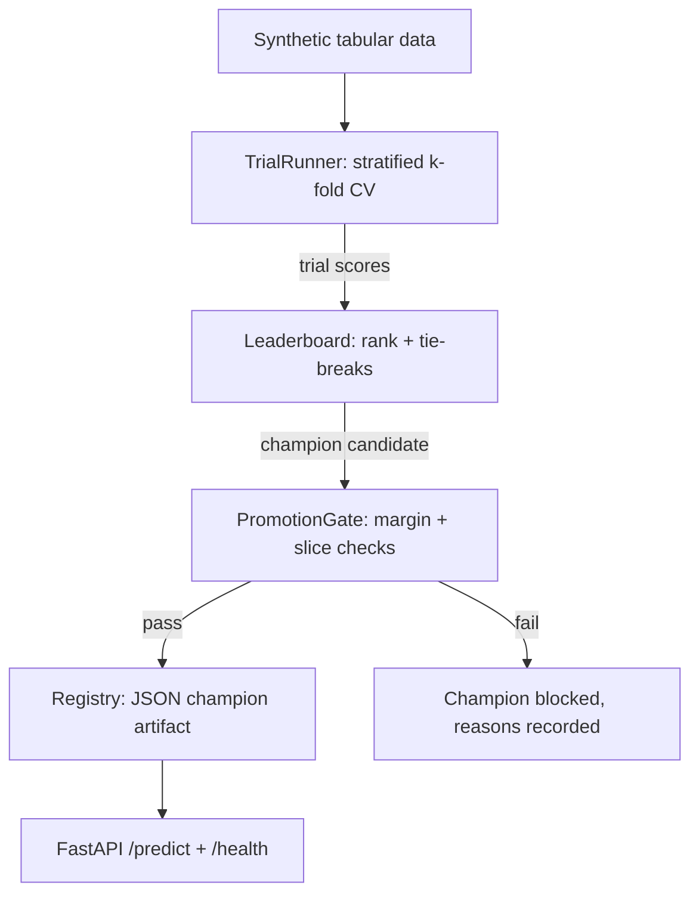

# Architecture

## Components

| Module | Responsibility |
| --- | --- |
| `automl/datasets.py` | Synthetic classification generator (signal/noise mix) + deterministic train/test split |
| `automl/models.py` | Candidate models from scratch: majority baseline, k-NN, CART tree/stump, logistic regression; shared `BaseModel` interface with JSON-serializable params |
| `automl/evaluation.py` | Accuracy, precision/recall/F1, rank-based ROC-AUC, log loss; deterministic stratified k-fold |
| `automl/search.py` | Search space, per-trial k-fold CV, primary-metric scoring, early stopping on stagnant trials |
| `automl/leaderboard.py` | Deterministic ranking: primary score desc, complexity asc, name asc |
| `automl/registry.py` | Promotion gate (baseline margin + per-slice checks) and JSON champion registry |
| `automl/service.py` | Optional FastAPI prediction service serving a registered champion |
| `demo.py` / `app.py` | End-to-end demo and service entrypoint |

## Flow



ASCII equivalent:

```
data ──▶ TrialRunner ──▶ Leaderboard ──▶ PromotionGate ──┬─▶ Registry ──▶ Service
                                                        └─▶ blocked (reasons)
```

## Data flow details

1. `generate_classification` produces features where the first
   `n_informative` columns carry the signal and the rest are noise.
2. `TrialRunner.run` evaluates each search-space config on every fold,
   averages metrics, then refits the trial's model on the full training
   set so the artifact it yields is usable.
3. `Leaderboard` sorts trials; `champion` is rank 1.
4. `PromotionGate.check` compares the champion against the baseline
   trial on the same evaluation set: margin first, then each declared
   slice (feature-threshold split) for accuracy collapse.
5. `Registry.register` writes the champion's `to_params()` output plus
   metrics to a JSON file; `load_model` reconstructs the model class
   from its stored `model_type` — no retraining, no pickle.

## Failure modes handled

- **Stagnant search:** early stopping after `patience` trials without
  improvement beyond `min_delta`.
- **Single-class folds:** ROC-AUC returns 0.5 instead of crashing.
- **Degenerate slices:** empty slices are skipped, not scored.
- **No champion registered:** the service returns 503, not a stale model.
- **Missing FastAPI:** the service module is never imported by the core,
  and its tests skip cleanly.
```

## Extension points

- New model: subclass `BaseModel`, implement `fit`/`predict_proba`/
  `to_params`/`from_params`, register it in `MODEL_CLASSES`.
- New metric: add an entry to `METRIC_FNS` in `search.py` and set it
  as `primary_metric`.
- New slice: pass additional `SliceSpec` values to `PromotionGate`.
- Real data: replace `generate_classification` with a loader that
  yields the same `(X, y)` shape; nothing downstream changes.
